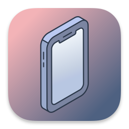
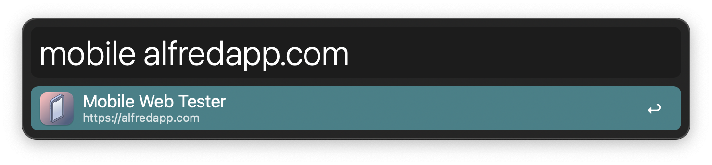
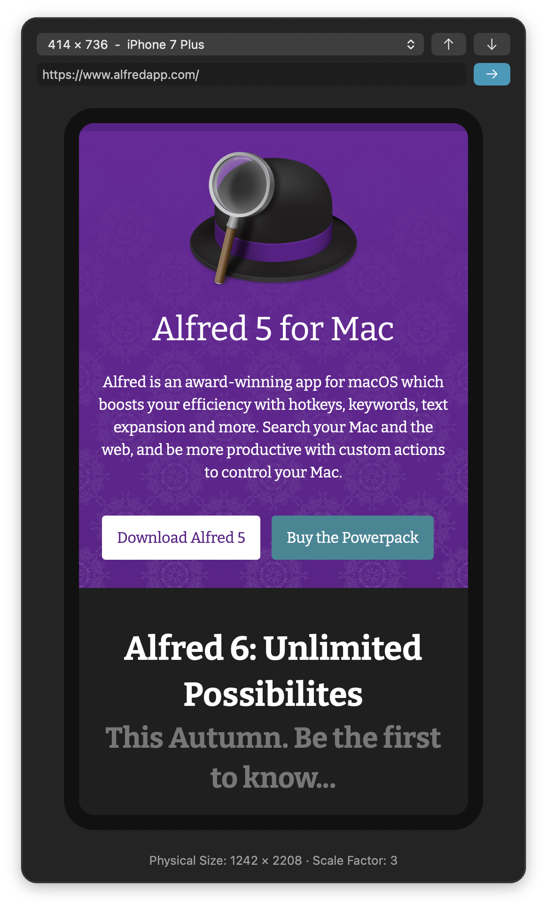
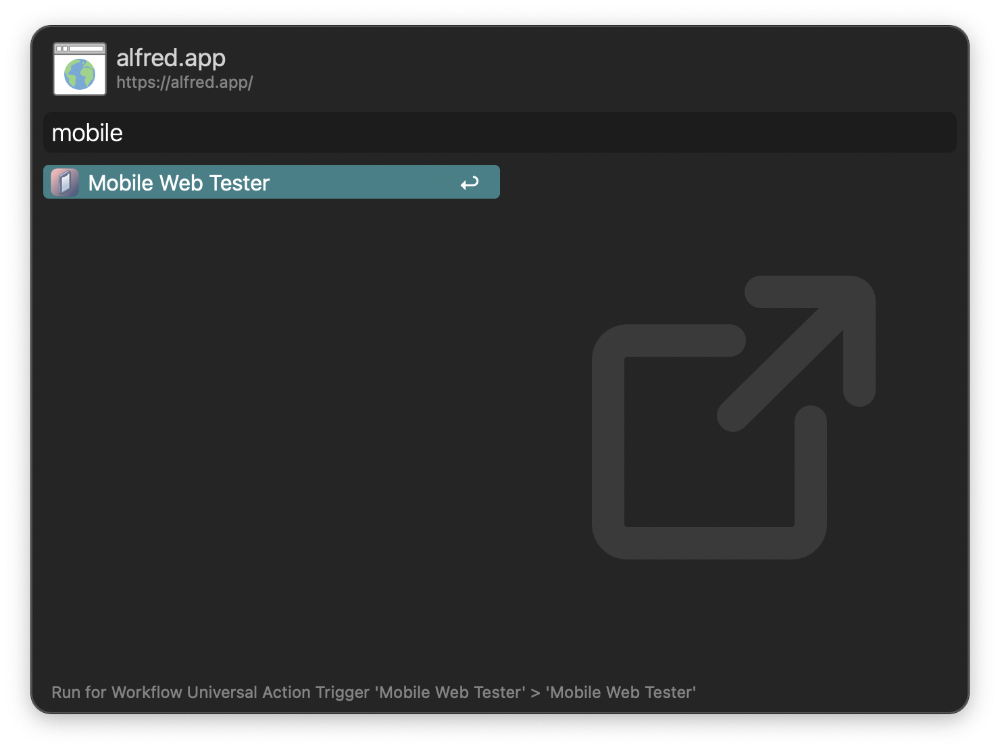

#  Mobile Web Tester Alfred Workflow

View websites on a variety of device sizes

[⤓ Install on the Alfred Gallery](https://alfred.app/workflows/alfredapp/mobile-web-tester)

## Usage

Test a website on multiple mobile device sizes via the `mobile` keyword.

* <kbd>⌘</kbd><kbd>P</kbd> Focus device picker.
* <kbd>⌘</kbd><kbd>↑</kbd> Select previous device.
* <kbd>⌘</kbd><kbd>↓</kbd> Select next device.
* <kbd>⌘</kbd><kbd>L</kbd> Focus URL field.
* <kbd>⌘</kbd><kbd>↩&#xFE0E;</kbd> Reload URL in field.

Alternatively, open a URL to test via the [Universal Action](https://www.alfredapp.com/help/features/universal-actions/).

Edit the list of devices or configure the window to open separately in the [Workflow’s Configuration](https://www.alfredapp.com/help/workflows/user-configuration/).
